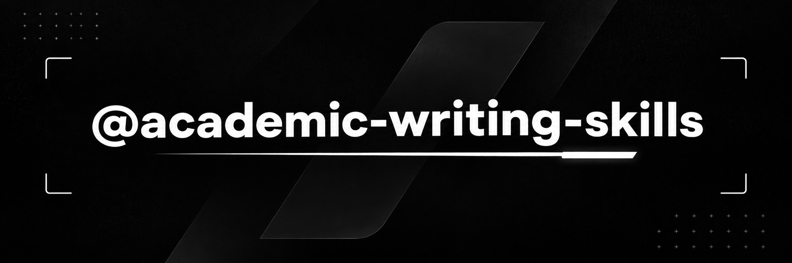
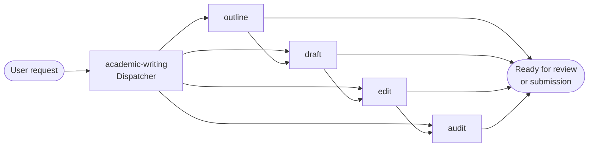

# academic-writing-skills

General Indonesian academic writing skills, not tied to one campus. Five skills carry a document from outline to submission: a dispatcher routes the task, then outline builds the frame, draft writes the sections, edit fixes the language, and audit checks the result. They cover research theses, journal articles, internship reports, and technical reports. Campus rules are variables, not hardcoded text. The audit also examines the internal logic of the research, cross-section consistency, methodology fit, and claim-evidence alignment—not only campus-guideline compliance. Give the skill a guide file and it adapts. Without a guide it uses common Indonesian defaults and marks every uncertain rule `[CHECK: campus guide]`.

Plain Agent Skills format: each skill is a folder with a `SKILL.md` at its root, so any agent that reads that format can use them.

## Contents

- [Skills](#skills)
- [Skill flow](#skill-flow)
- [Repository layout](#repository-layout)
- [How the campus adapter works](#how-the-campus-adapter-works)
- [Install](#install)
- [Updating](#updating)
- [Use](#use)
- [Validate](#validate)
- [Notes](#notes)
- [Attribution](#attribution)
- [License](#license)

## Skills

| Skill | What it does |
| --- | --- |
| `academic-writing` | Routes an academic writing task to the smallest suitable skill or chain: outline, draft, edit, audit. Identifies genre, applicable rules, evidence, and the next step. Use for end-to-end help or when unsure which specialist fits. |
| `outline` | Builds and checks the outline before drafting, or condenses existing files into one outline. Starts from a core map of the gap (Should versus Is), adapts to any campus guide through 14 variables, checks with the universal checklist, and gives the title last. |
| `draft` | Drafts Chapter I to Chapter V chapter by chapter from the student own material, with evidence-first discipline, quantitative, qualitative, and R and D paths, and export to Markdown, DOCX, and PDF. |
| `edit` | Edits Indonesian academic prose without changing its facts: EYD V and KBBI, effective sentences, and removal of machine-writing patterns, with clear editing scopes from typo fix to rewrite. |
| `audit` | Audits a draft against its campus guide and its own evidence: stage gates, four layered checks, reference verification through Garuda, SINTA, OpenAlex, and Crossref, and a prioritized findings report. |

Each skill folder also holds a `references/` directory with the deep material the skill loads on demand, for example `skills/outline/references/guide-adapter.md` or `skills/edit/references/ai-patterns.md`.

## Skill flow



The dispatcher routes each request to the smallest suitable skill or chain: a single skill for a single job, the full `outline` → `draft` → `edit` → `audit` chain for end-to-end work, skipping stages that are already done or irrelevant. It also picks the genre route: research theses use the chapter references (I–V), journal articles follow the target venue rules, internship and KP reports use placement checks, and technical reports follow purpose and evidence.

## Repository layout

```
academic-writing-skills/
├── skills/
│   ├── academic-writing/ # dispatcher: route to the smallest suitable skill set
│   │   └── SKILL.md
│   ├── outline/          # frame, gap map, 14 variables, checklist
│   │   ├── SKILL.md
│   │   └── references/   # guide-adapter, checklist, genre-research, genre-report, genre-article
│   ├── draft/            # Chapter I to V, abstracts, export
│   │   ├── SKILL.md
│   │   └── references/   # chapter1..chapter5, export, article-manuscript
│   ├── edit/             # EYD V, KBBI, machine patterns
│   │   ├── SKILL.md
│   │   └── references/   # ai-patterns, eyd-kbbi, keep-it, editing-scopes
│   └── audit/            # gates, layered QC, reference verification
│       ├── SKILL.md
│       └── references/   # gates, layered-qc, reference-verification, finding-report, genre modules
├── shared/
│   ├── campus-presets.md     # index of presets and how to add one
│   ├── institution-profile.md
│   ├── workflow-contract.md  # shared routing, evidence labels, handoffs
│   └── presets/
│       └── generic.yml       # national default, 4-4-3-3 margins
├── docs/
│   └── banner.jpg            # README banner
├── scripts/
│   └── validate_package.py   # packaging checks, standard library only
├── tests/
│   └── test_validate_package.py
├── install.sh
├── LICENSE
└── README.md
```

The skill text refers to `shared/campus-presets.md` and `shared/presets/` relative to the skills root. Keep the `shared/` folder next to the five skill folders after installing, or the preset lookup will not resolve.

## How the campus adapter works

1. Give the skill a guide file (PDF or DOCX). It reads the guide and fills the 14 variables in `skills/outline/references/guide-adapter.md`.
2. Without a guide file, it uses the preset in `shared/campus-presets.md` when the campus has one, or the national defaults in `shared/presets/generic.yml`.
3. Every variable value shown to the user carries its source: guide plus page, preset, or default marked `[CHECK]`. A value with no source never appears.
4. Add a new campus by copying `shared/presets/generic.yml`, filling it from the guide, and listing it in `shared/campus-presets.md`.

## Install

Prerequisites: `git`, and `python3` if you want to run the validator. Nothing else is required, the skills are plain Markdown.

Pick the skills directory your agent reads. User scope applies to every project on the machine, project scope applies to one repository.

| Agent | User scope | Project scope |
| --- | --- | --- |
| Claude Code | `~/.claude/skills` | `.claude/skills` |
| OpenCode | `${XDG_CONFIG_HOME:-~/.config}/opencode/skills` | `.opencode/skills` |
| Codex | `~/.agents/skills` | `.agents/skills` |
| Hermes | `~/.hermes/skills` | not applicable |
| CodeBuddy | `~/.codebuddy/skills` | `.codebuddy/skills` |

The `cp` blocks below are for a first install. Re-running them over an existing install nests the folders, so use `./install.sh` for repeat runs, or delete the target folder first.

### Claude Code

```bash
git clone https://github.com/Nbill27/academic-writing-skills.git
cd academic-writing-skills
mkdir -p ~/.claude/skills
cp -r skills/academic-writing skills/outline skills/draft skills/edit skills/audit ~/.claude/skills/
cp -r shared ~/.claude/skills/shared
```

Verify with `claude --help`, then ask for a skill by name inside a session.

### OpenCode

```bash
git clone https://github.com/Nbill27/academic-writing-skills.git
cd academic-writing-skills
mkdir -p "${XDG_CONFIG_HOME:-$HOME/.config}/opencode/skills"
cp -r skills/academic-writing skills/outline skills/draft skills/edit skills/audit "${XDG_CONFIG_HOME:-$HOME/.config}/opencode/skills/"
cp -r shared "${XDG_CONFIG_HOME:-$HOME/.config}/opencode/skills/shared"
```

Verify with `opencode --help`, then ask for a skill by name inside a session.

### Codex

```bash
git clone https://github.com/Nbill27/academic-writing-skills.git
cd academic-writing-skills
mkdir -p ~/.agents/skills
cp -r skills/academic-writing skills/outline skills/draft skills/edit skills/audit ~/.agents/skills/
cp -r shared ~/.agents/skills/shared
```

Verify with `codex --help`. Codex reads `~/.agents/skills` for user scope and `.agents/skills` inside a project, not `~/.codex/skills`.

### Hermes

```bash
git clone https://github.com/Nbill27/academic-writing-skills.git
cd academic-writing-skills
mkdir -p ~/.hermes/skills
cp -r skills/academic-writing skills/outline skills/draft skills/edit skills/audit ~/.hermes/skills/
cp -r shared ~/.hermes/skills/shared
hermes skills list
```

### CodeBuddy

```bash
git clone https://github.com/Nbill27/academic-writing-skills.git
cd academic-writing-skills
mkdir -p ~/.codebuddy/skills
cp -r skills/academic-writing skills/outline skills/draft skills/edit skills/audit ~/.codebuddy/skills/
cp -r shared ~/.codebuddy/skills/shared
```

Verify with `codebuddy skills list`.

### Installer script

`install.sh` does the same copy for one target at a time and is safe to rerun.

```bash
git clone https://github.com/Nbill27/academic-writing-skills.git
cd academic-writing-skills
./install.sh --claude-code
```

| Flag | Target | Default |
| --- | --- | --- |
| none | `~/.hermes/skills` | yes |
| `--hermes` | `~/.hermes/skills` | |
| `--codebuddy` | `~/.codebuddy/skills` | |
| `--claude-code` | `~/.claude/skills` | |
| `--opencode` | `${XDG_CONFIG_HOME:-~/.config}/opencode/skills` | |
| `--codex` | `~/.agents/skills` | |
| `-h`, `--help` | prints usage, installs nothing | |

The script refuses to run outside the repo root and prints the resulting directory plus the command that verifies the install.

### Project scope

Copy the same five entries into the project directory instead of the home directory. The folder names must stay as they are, because the `name` in each frontmatter matches its directory name.

```bash
mkdir -p .claude/skills
cp -r skills/academic-writing skills/outline skills/draft skills/edit skills/audit .claude/skills/
cp -r shared .claude/skills/shared
```

Swap `.claude/skills` for `.opencode/skills`, `.agents/skills`, or `.codebuddy/skills` for the other agents.

### Uninstall

```bash
rm -rf ~/.claude/skills/academic-writing ~/.claude/skills/outline ~/.claude/skills/draft \
       ~/.claude/skills/edit ~/.claude/skills/audit ~/.claude/skills/shared
```

Adjust the base directory for the agent you installed into. Remove `shared/` only if no other skill set uses it.

## Updating

There is no auto-update. Installing copies the skill folders into the agent's skills directory, so the agent reads that copy, not this repository. Pulling the latest repo alone does not change an installed copy.

To update an installed family:

```bash
cd academic-writing-skills
git pull
./install.sh
```

Replace `./install.sh` with `./install.sh --claude-code` (or another flag) to update only one agent. The installer removes each skill folder before copying, so a reinstall cannot leave behind a file that no longer ships in the new version. A plain `cp -r` does not do this: it merges into the old folder and leaves stale files in place, so use the installer for updates.

### Updating with the updater

From v1.1.0 on, the installed dispatcher folder ships its own updater at `scripts/update.py` (standard library only, no Git needed). Run it from the installed dispatcher folder, for example `~/.hermes/skills/academic-writing/`:

```bash
python scripts/update.py version
python scripts/update.py check-update
python scripts/update.py update
python scripts/update.py rollback
```

`check-update` only compares the installed version with the latest GitHub Release and changes nothing. `update` downloads that release, extracts it safely, runs the package validator from the extracted release, backs the current family up outside the skills directory, and only then replaces the five skills plus `shared/`; if the replacement fails, the backup is restored. `rollback` restores the latest backup. Add `--yes` to skip the confirmation prompt, and `--to 1.2.0` to update to a specific version instead of the latest. There is no automatic update. The updater needs Python 3.10 or newer; it does not need Git or a package manager. SHA-256 is only claimed as a cryptographic check when the release carries a `SHA256SUMS.txt` asset with a matching entry and the hash matches; otherwise the update is validated by safe extraction plus the package validator.

Bootstrap: a v1.0.0 installation has no updater yet, so install v1.1.0 once with the installer above first. After that, the updater handles later versions. Backups are kept in the user cache directory (`~/.cache/academic-writing-skills/backups` on Linux and macOS, `%LOCALAPPDATA%\academic-writing-skills\backups` on Windows), not inside the skills directory.

After updating, start a new agent session. A running session may still use the old copy. Then check the installed version matches the repo:

```bash
grep "^version:" ~/.hermes/skills/academic-writing/SKILL.md
```

Compare it with the newest entry in [CHANGELOG.md](CHANGELOG.md). There is no update notification: check the changelog or the release tags on GitHub when you want to know if a new version exists.

## Use

Ask the agent to outline, draft, edit, or audit an academic document. The skill loads when the request matches: outline, draft chapter, background, literature review, research methods, results and discussion, conclusions and suggestions, check language, check spelling, edit manuscript, audit report, check bibliography, or ready for defense.

Typical flow: `academic-writing` routes the request to the smallest suitable skill or chain, `outline` for the outline, `draft` for drafting one chapter at a time, `edit` for language, `audit` for the final check before submission. For a journal article, the dispatcher routes to the article references instead of the thesis chapters.

The skills work on files in the current project. Point the agent at the guide file and the draft, then name the skill you want. Nothing is uploaded anywhere, the work stays in the local session.

## Research coherence audit

For a Markdown or DOCX thesis, prepare a traceable workspace, complete the AI review, then validate every finding against an exact manuscript quote:

```bash
python skills/audit/scripts/prepare_research_audit.py draft.docx --level undergraduate --out .research-audit/draft-01
# Complete audit.json using audit.json.template and research-audit-schema.md
python skills/audit/scripts/validate_research_audit.py .research-audit/draft-01
python skills/audit/scripts/revision_impact.py old.md new.md --output revision-impact.md
```

The scripts use the Python standard library. Automatic signals are candidates, not academic verdicts. See `skills/audit/references/research-coherence.md` and `docs/THIRD_PARTY_ATTRIBUTION.md`.

## Validate

```bash
python3 scripts/validate_package.py
```

Checks frontmatter names and descriptions, required repo files, local link targets, preset keys, and absolute local paths in skill files. Exit code `0` prints `OK: package structure, metadata, and local references are valid.`, exit code `1` lists every problem found. The validator checks packaging only; it does not test academic content, source truth, or agent runtime behavior.

Unit tests for the validator live in `tests/`:

```bash
python3 -m unittest discover -s tests
```

Pass a path to validate a copy somewhere else:

```bash
python3 scripts/validate_package.py /path/to/academic-writing-skills
```

## Notes

- Releases are versioned tags starting at v1.0.0; see [CHANGELOG.md](CHANGELOG.md) for what changed in each version.
- The skills never invent data, respondents, sources, numbers, or results. Missing material is marked `[NEED: ...]` and unverified material is marked `[CHECK: ...]`.
- The skills refuse ghostwriting and requests to disguise AI output as the student own writing. Removing machine patterns from the student own writing is honest editing. Evading AI detectors is not.
- A preset never replaces the guide. When a preset and the user guide disagree, the guide wins and the difference is flagged.
- Only the generic preset ships here. The full campus sets live in the upstream repos listed under Attribution, all MIT licensed. Copy a preset in, verify it against the current guide, and note the source.

## Attribution

This repo adapts mechanics, workflows, and reference material from these MIT-licensed projects. Their original authors keep their copyright. See each source for its full text.

- [rangka](https://github.com/bryankwandou/rangka) by Bryan Kwandou: core map, title last, pedoman adapter with 14 variables, universal checklist, genre templates, campus notes.
- [naskah-id](https://github.com/nothinx/naskah-id) by nothinx: EYD V and KBBI editing modules, machine-pattern catalog, do-not-correct list, change boundaries, long-document workflow, reference verification.
- [proposal-skripsi-skill](https://github.com/bimajanuri/proposal-skripsi-skill) by Bima Januri: Chapter I to III proposal pipeline, 28 campus presets, stage gates, layered QC with red-team review, statistical analysis from real datasets, citation export.
- [indonesian-academic-writing](https://github.com/azkadani214/indonesian-academic-writing) by azkadani214: modular references by task, institution profile template, package validation script.
- [laporan-generator](https://github.com/muadzhdz/laporan-generator) by muadzhdz: YAML campus presets, Pandoc and Typst export to DOCX and PDF.
- [Bina Insani KP Companion](https://github.com/Nbill27/kp-skill) by Muhammad Nabil Deja: chapter drafting guidance, evidence classification and traceability, audit phases, severity rubric, finding report template.

## License

MIT. See [LICENSE](LICENSE).
